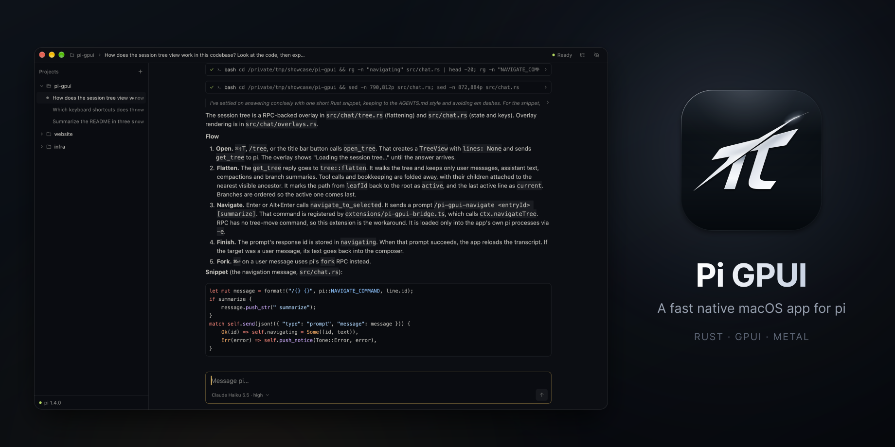

# Pi GPUI



A fast native macOS app for [pi](https://github.com/earendil-works/pi), built with GPUI. It runs your installed pi over RPC, so your models, extensions, skills and sessions work as they do in the terminal.

## Install

Download `Pi-GPUI-*.zip` from [Releases](https://github.com/bytesbay/pi-gpui/releases) and move the app to Applications. The app updates itself: when a new version is downloaded, "Restart to update" appears in the title bar.

Needs pi 1.4 or newer within pi 1.x. The app finds pi in `PI_EXECUTABLE`, `PATH` or your login shell (so nvm installs work).

## Features

- Projects and their pi sessions in a sidebar. Every open session runs its own pi, so switching never stops work.
- Slash commands: pi's extension commands, prompt templates and skills, plus `/compact`, `/tree`, `/fork`, `/clone`, `/model`, `/new`, `/name`, `/session`, `/copy`, `/export`.
- Session tree with keyboard navigation and branch summaries.
- Fork from any message.
- Per-session model and thinking level, without touching pi's defaults.
- Markdown answers styled after Zed's agent panel, with syntax-highlighted code; all transcript text is selectable.
- Compaction shown in the transcript with token counts and the summary.
- Colors follow the theme you picked in pi-gui.
- Sessions can be renamed, hidden or deleted (to the Trash).

## Keys

| Keys | Action |
|---|---|
| `⌘N` | New session |
| `⌘O` | Add project |
| `⌘1` … `⌘9` | Open the n-th session (hold `⌘` to see numbers) |
| `⌘⇧T` | Session tree |
| `⌘⇧M` | Model and thinking level |
| `⌘⇧E` | Expand or collapse step details |
| `↩` / `⇧↩` | Send / new line (sending while pi works steers it) |
| `Esc` | Stop the run |
| `/` | Command menu |

In the tree: `↑↓` move, `←→` jump between branches, `↩` go there, `⌥↩` go there and summarize the branch you leave, `⌘↩` fork from your message.

## Compatibility

The app has its own version and supports a range of pi versions (`MIN_PI` and `TESTED_PI` in `src/pi.rs`). pi minors newer than the tested one still run, marked "not tested yet". Each release publishes `pi-compat.json`, and the updater only offers releases that support your pi. The app never updates pi.

Tree navigation needs something pi's RPC lacks, so the app passes a small extension of its own (`extensions/pi-gpui-bridge.ts`) to the pi processes it starts. Nothing is installed.

## Known limits

- Open sessions stay open until you quit.
- Extension dialogs (`select`, `confirm`, `input`, `editor`) are cancelled with a notice.
- A pi running in a terminal on the same session is not detected.

## Development

```sh
cargo run [-- /path/to/project]
cargo test && cargo clippy --all-targets
script/bundle.sh        # target/release/Pi GPUI.app
script/release.sh       # tag the Cargo.toml version; CI builds and publishes the release
```

Rust 1.90 (pinned) and Xcode. Shaders compile at startup, so the Metal Toolchain is not needed. Set `PI_GPUI_PRETEND_VERSION=<older>` to try the update flow against a real release.

Docs: [principles](docs/APP_PRINCIPLES.md), [GPUI practices](docs/GPUI_STYLE_GUIDE.md), [plugins](docs/PLUGINS.md).
