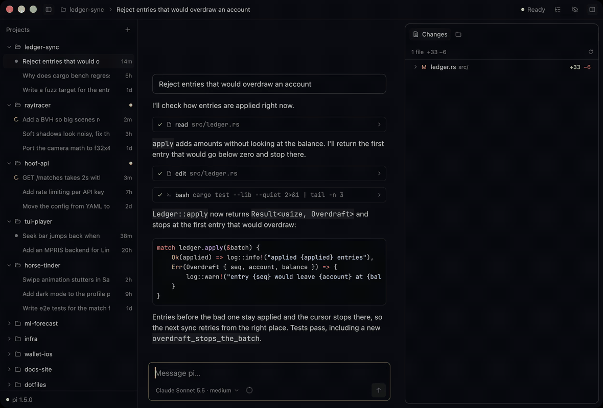
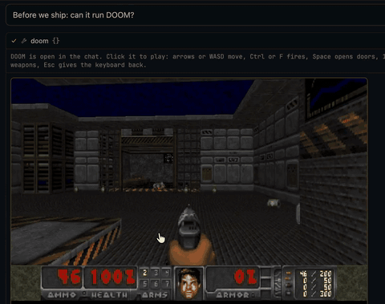

# Pi GPUI

[English](../README.md) | 中文

[pi](https://github.com/earendil-works/pi) 编程智能体的原生桌面客户端，用 Rust 和 [GPUI](https://www.gpui.rs)（Zed 编辑器使用的 UI 框架）编写。目前支持 macOS，接下来是 Linux。没有 Electron，也没有 webview。它通过 RPC 运行你已经安装的 pi，所以你的模型、扩展、技能和会话都和在终端里一样可用。

应用大小 16 MB，窗口约 0.4 秒出现，空闲时占用约 75 MB 内存。基于 Electron 的 pi 客户端需要 0.5 到 1.1 秒和 190 到 430 MB（[测试方法](BENCHMARKS.md)）。

[官网](https://pi-gpui.dev) · [下载](https://github.com/bytesbay/pi-gpui/releases/latest) · [插件文档（英文）](PLUGINS.md)



## 安装

```sh
brew install --cask bytesbay/tap/pi-gpui
```

也可以从 [Releases](https://github.com/bytesbay/pi-gpui/releases) 下载 `Pi-GPUI-*.zip`，把应用拖进「应用程序」。安装包经过 Apple 签名和公证。应用会自动更新：新版本下载完成后，标题栏会出现 "Restart to update"。需要 Apple 芯片和 macOS 13 或更高版本。

暂不支持 Linux 和 Windows。Linux 版本在计划中：关注或给 [#5](https://github.com/bytesbay/pi-gpui/issues/5) 点 👍，发布时会收到通知。

需要 pi 1.4 或更高的 1.x 版本。应用会在 `PI_EXECUTABLE`、`PATH` 或登录 shell 中查找 pi（所以 nvm 安装的 pi 也能找到）。

想把终端里正在进行的会话转到应用里，给 pi 加上 `/gpui` 命令：

```sh
pi install npm:pi-gpui
```

`/gpui` 会关闭终端里的 pi，并在 Pi GPUI 中打开同一个会话。其他工具也可以用链接做到：`open "pi-gpui://open?workspace=/项目/路径&session=/会话/文件.jsonl"`（session 可省略）。

## 它能跑 DOOM

插件可以用任何语言编写，并在工具调用里显示实时画面。[这个插件](../examples/plugins/doom)给 pi 加了一个 `doom` 工具：



## 功能

- 侧边栏显示项目和各自的 pi 会话。每个打开的会话都运行自己的 pi，切换会话不会中断工作。
- 斜杠命令：pi 扩展的命令、提示模板和技能，以及 `/compact`、`/tree`、`/fork`、`/clone`、`/model`、`/new`、`/name`、`/session`、`/copy`、`/export`。
- 会话树，支持键盘导航和分支摘要。
- 可以把文件和图片粘贴或拖进输入框，和 pi 终端一样以路径发送。消息和工具结果里的图片会直接显示。
- 从任意一条消息分叉。
- 扩展的提问（`select`、`confirm`、`input`、`editor`）直接在对话中显示：点击、数字键或方向键选择，也可以自己输入答案。
- 任意语言的插件：按钮、快捷键、状态栏、给 pi 的工具，以及工具调用中的实时画面。见 [PLUGINS.md](PLUGINS.md)。
- 每个会话可以单独选择模型和思考级别，不改动 pi 的默认设置。
- Markdown 回答的样式参考 Zed 的 agent 面板，代码有语法高亮，所有文字都可以选中。
- 模型旁边的上下文环：已用上下文和压缩时机、提示缓存命中率和过期时间、订阅额度、会话的 token 总数。
- 压缩会显示在对话中，带 token 数和摘要。
- Ayu Dark 和 Ayu Light 主题，默认跟随 macOS。
- 会话可以重命名、隐藏、关闭（⌘W 停止它的 pi，会话保留）或删除（移到废纸篓）。
- pi 和扩展的更新显示在 pi 版本旁边，并说明应用是否支持新的 pi。只有你点击时才会用 pi 自己的 `pi update` 更新。

## 快捷键

| 按键 | 操作 |
|---|---|
| `⌘N` | 新会话 |
| `⌘,` | 设置 |
| `⌘O` | 添加项目 |
| `⌘1` … `⌘9` | 打开第 n 个会话（按住 `⌘` 显示编号） |
| `⌘⇧R` | 重新加载所有打开的会话 |
| `⌘B` / `⌘R` | 显示或隐藏左侧 / 右侧面板 |
| `⌘⇧T` | 会话树 |
| `⌘⇧M` | 模型和思考级别 |
| `⌘⇧E` | 展开或折叠步骤详情 |
| `↩` / `⇧↩` | 发送 / 换行（pi 工作时发送会引导它） |
| `Esc` | 停止运行 |
| `/` | 命令菜单 |

## 设置

`~/Library/Application Support/pi-gpui/settings.json` 是唯一的配置来源。保存后立即生效，所以你或 pi 都可以直接编辑它；设置页（`⌘,`）写的是同一个文件，并保留注释。

开发、签名和兼容性说明见[英文 README](../README.md)。

## 许可证

MIT
