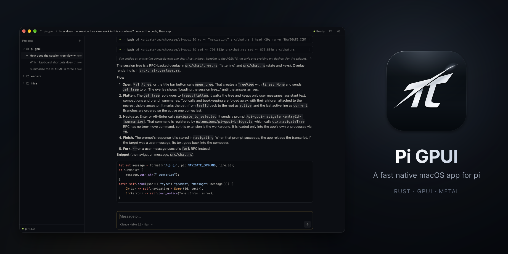

# pi-gpui

`/gpui` for pi: continue the session you have open in the terminal in [Pi GPUI](https://github.com/bytesbay/pi-gpui), the native Mac app for pi written in Rust with GPUI.



## Install

```sh
pi install npm:pi-gpui
brew install --cask bytesbay/tap/pi-gpui   # the app, if you don't have it yet
```

## Use

Type `/gpui` in pi. This pi exits, and the same session opens in Pi GPUI with its project in the sidebar. Without a saved session (`--no-session`), the project opens there with a new session.

The terminal pi exits first because pi does not protect a session file from two writers.

Needs Pi GPUI 0.1.10 or newer on macOS. Any tool can do the same with a link:

```sh
open "pi-gpui://open?workspace=/path/to/project&session=/path/to/session.jsonl"
```

## License

MIT
